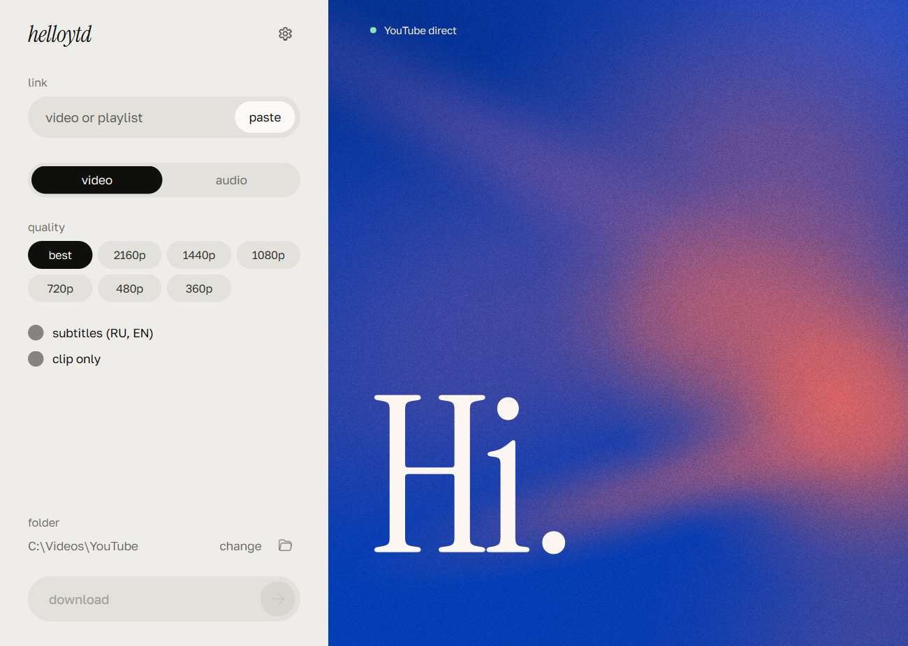

<div align="center">
  
  <h1>helloytd</h1>
  <p>Save YouTube videos, audio, and clips. A portable app for Windows.</p>
  <p><a href="https://github.com/sstrodee/helloytd/releases/latest"><strong>Download for Windows ↗</strong></a> · <a href="README.ru.md">Русский</a></p>
</div>



## Quick start

1. Download the `windows-x64` ZIP from [Releases](https://github.com/sstrodee/helloytd/releases).
2. Extract the entire archive to a writable folder and open `helloytd.exe`.
3. Paste a link, choose video or audio, and select **download**.

**Requirements:** Windows 10 (1809 or later) or Windows 11, x64. Python is included. Install [FFmpeg](https://ffmpeg.org/download.html) and either [Node.js](https://nodejs.org/) or [Deno](https://deno.com/) separately. Settings shows which components were detected.

## Features

- Video up to 4K when the source offers it.
- MP3 at 192 or 320 kbps and M4A, with metadata and cover art.
- Clips by timestamp, such as `1:30–4:00`. Video clips are capped at 1080p.
- Select individual items from a playlist and save English or Russian subtitles as separate SRT files.
- Download queue, history, cancel, and retry.

Format and subtitle availability depend on the source. Only download material that can be accessed and saved with permission.

## Settings and updates

- The app follows the Windows display language. To set English or Russian manually, use **Settings → Language** and restart.
- Settings, history, and cache are stored in `data` next to the EXE or in `%APPDATA%\helloytd` if the portable folder is read-only.
- The app detects a route to YouTube automatically. A manual proxy can be set in Settings.
- Browser cookies are used according to the selected sign-in preference. The default tries without them first.
- If YouTube changes the formats it serves, select **update yt-dlp** in Settings and restart after the update.

When reporting a bug, include the app and yt-dlp versions, the selected mode, and the error message. Leave out browser cookies, private links, and proxy credentials.

## Build from source

```powershell
powershell -ExecutionPolicy Bypass -File build_portable.ps1 -OutputName helloytd-local
dist\helloytd-local\runtime\python.exe run_tests.py
```

The script verifies the embedded Python archive and DLL signature, installs dependencies, compiles the Windows launcher, and creates the portable ZIP. Use an unused output name. Test dependencies are installed in `.test-deps`.

To prepare a versioned Windows release ZIP with license notices and a SHA-256 file:

```powershell
dist\helloytd-local\runtime\python.exe -B tools\package_release.py dist\helloytd-local-portable.zip
```

helloytd is licensed under [MIT](LICENSE) and uses [yt-dlp](https://github.com/yt-dlp/yt-dlp) and [Qt for Python](https://doc.qt.io/qtforpython-6/). See the [third-party notices](THIRD_PARTY_NOTICES.md) for bundled licenses and sources.
