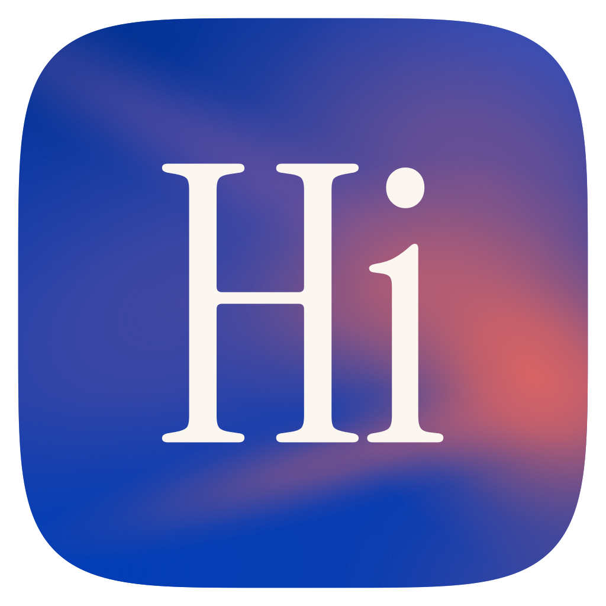
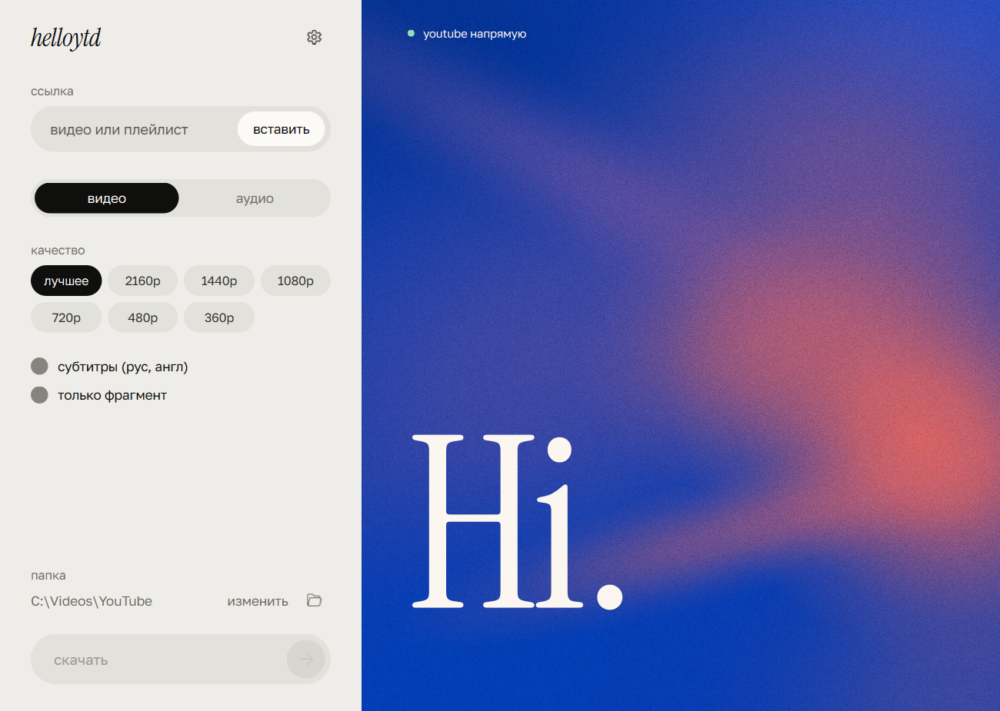

<div align="center">
  
  <h1>helloytd</h1>
  <p>Видео, звук и фрагменты с YouTube. Portable-приложение для Windows.</p>
  <p><a href="https://github.com/sstrodee/helloytd/releases/latest"><strong>Скачать для Windows ↗</strong></a> · <a href="README.md">English</a></p>
</div>



## Быстрый старт

1. В [Releases](https://github.com/sstrodee/helloytd/releases) скачать ZIP с пометкой `windows-x64`.
2. Распаковать архив целиком в папку с доступом на запись и открыть `helloytd.exe`.
3. Вставить ссылку, выбрать видео или звук и нажать «скачать».

**Windows 10 (1809+) или Windows 11, x64.** Сборка проверена на Windows 11. Python уже внутри архива. Для обработки видео и звука нужен [FFmpeg](https://ffmpeg.org/download.html). Для работы с YouTube нужен [Node.js](https://nodejs.org/) или [Deno](https://deno.com/). В настройках helloytd видно, какие компоненты найдены.

## Возможности

- Видео до 4K при наличии соответствующего формата.
- MP3 192/320 кбит/с и M4A, с метаданными и обложкой.
- Фрагменты по таймкодам, например `1:30–4:00`. Для видеофрагментов — до 1080p.
- Выбор отдельных роликов из плейлиста и субтитры на русском и английском отдельным SRT-файлом.
- Очередь, история, отмена и повтор скачивания.

Доступные форматы и субтитры зависят от ролика. Скачивание предполагает доступ к материалу и право сохранить его.

## Настройки и обновления

- Настройки, история и кэш хранятся в `data` рядом с EXE. Если папка защищена от записи, данные сохраняются в `%APPDATA%\helloytd`. Для переноса настроек между portable-копиями достаточно скопировать `data` после закрытия программы.
- Язык определяется по языку Windows. В «Настройки» → «Язык» можно выбрать английский или русский. Изменение применяется после перезапуска.
- Маршрут к YouTube выбирается автоматически. Ручной прокси можно указать в настройках приложения.
- Cookies берутся из выбранного браузера, если требуется вход и это разрешено в настройках. По умолчанию первая попытка проходит без них.
- В случае изменений на стороне YouTube в настройках есть кнопка «обновить yt-dlp». Новая версия yt-dlp активируется после перезапуска приложения.

Для сообщения об ошибке пригодятся версия helloytd, версия yt-dlp, выбранный режим и текст ошибки. Личные данные, cookies и адреса прокси с паролями в отчёт не нужны.

## Сборка из исходников

```powershell
powershell -ExecutionPolicy Bypass -File build_portable.ps1 -OutputName helloytd-local
dist\helloytd-local\runtime\python.exe run_tests.py
```

Скрипт проверяет архив и подпись встроенного Python, устанавливает зависимости, собирает Windows-запускатель и создаёт portable ZIP. Выходное имя должно быть свободно. Зависимости тестов устанавливаются в `.test-deps`.

После проверки сборки команда ниже добавляет документы о лицензиях и создаёт Windows ZIP с номером версии и SHA-256 для Releases.

```powershell
dist\helloytd-local\runtime\python.exe -B tools\package_release.py dist\helloytd-local-portable.zip
```

Код helloytd доступен по [лицензии MIT](LICENSE). Проект использует [yt-dlp](https://github.com/yt-dlp/yt-dlp) и [Qt for Python](https://doc.qt.io/qtforpython-6/). Сведения о включённых библиотеках, шрифтах и их лицензиях приведены в [THIRD_PARTY_NOTICES.md](THIRD_PARTY_NOTICES.md).
